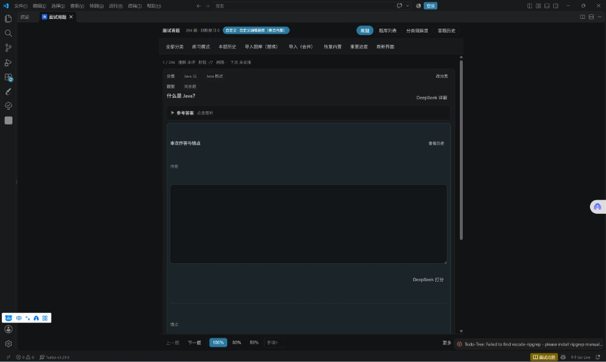

# beibagu · 面试背题

<p align="center">
  
  
</p>
<p align="center">
  <b>IDEA</b> &nbsp;&nbsp;|&nbsp;&nbsp; <b>VS Code / Cursor</b>
</p>

**程序员上班摸鱼神器：刷八股文、背面试题。**  
IDEA / Cursor / VS Code **编辑器插件**，**免费开源**。

在编辑器里直接练：简答练习 · 错题强化 · 艾宾浩斯间隔复习 · 题库导入导出 · DeepSeek 详解 / 打分

开源地址：https://gitee.com/gooooooooo/beibagu

## 下载安装包

见仓库 [`releases/`](./releases/) 目录，或 [Releases 页面](https://gitee.com/gooooooooo/beibagu/releases)：

| 平台 | 文件 | 安装方式 |
|---|---|---|
| IntelliJ IDEA | `beibagu-idea-0.1.64.zip` | Settings → Plugins → 齿轮 → **Install Plugin from Disk…** |
| Cursor / VS Code | `beibagu-vscode-0.1.59.vsix` | 扩展面板 → **Install from VSIX…** |

安装后重启 IDE。打开方式：

- IDEA：右侧工具窗口「面试背题」，或 `Ctrl+Alt+B`
- Cursor / VS Code：左侧「面试背题」，或 `Ctrl+Alt+B` / `F9`

## 仓库结构

```
beibagu/
├── idea/       # IntelliJ IDEA 插件源码（Gradle）
├── vscode/     # Cursor / VS Code 插件源码
├── releases/   # 可直接安装的打包产物
├── LICENSE     # MIT
└── README.md
```

## 功能概览

- 内置 Java 面试核心题库（可按分类筛选）
- 三种模式：练习 / 错题强化 / 艾宾浩斯复习（7 档质量 ↔ 7 档间隔）
- 导入、导出题库 JSON；本地持久化进度
- DeepSeek 详解、打分（Chrome CDP 自动写入聊天框并发送）

## 本地开发

### IDEA 插件

需要 JDK 17+：

```powershell
cd idea
.\gradlew.bat buildPlugin
```

产物：`idea/build/distributions/beibagu-*.zip`

### VS Code / Cursor 插件

```powershell
cd vscode
npm run package
# 或安装到本机 Cursor：
.\install-to-cursor.ps1
```

产物：`vscode/beibagu-*.vsix`

## 题库说明

内置题库整理自「二哥的 Java 进阶之路 / 面渣逆袭」等公开面试资料，**仅供个人学习**。商业使用请自行确认版权。

## License

[MIT](./LICENSE)
