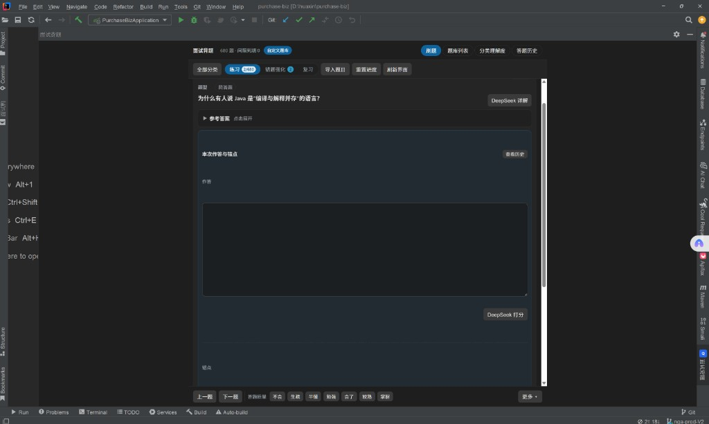

# beibagu · 编辑器插件 · 摸鱼刷题 · AI 辅助解析 / 理解 / 记忆

> IDEA / VS Code 面试背题插件 · DeepSeek 一键详解打分 · 白嫖网页 Token · 免费开源

<p align="center"><b>IntelliJ IDEA</b></p>
<p align="center">
  
</p>
<p align="center"><b>VS Code</b></p>
<p align="center">
  
</p>

上班摸鱼刷八股，不用切窗口：题目直接丢给 **DeepSeek AI**——**详解**帮你理解，**打分**帮你记忆，网页对话自动填发送，**不烧自己的 API Token**。  
附赠：简答练习 · 错题强化 · 艾宾浩斯间隔复习 · 题库导入导出。

开源地址：
- Gitee：https://gitee.com/gooooooooo/beibagu
- GitHub：https://github.com/ETTTTTTTT/beibagu

## 下载安装包

见仓库 [`releases/`](./releases/) 目录，或 [Releases 页面](https://gitee.com/gooooooooo/beibagu/releases)：

| 平台 | 文件 | 安装方式 |
|---|---|---|
| IntelliJ IDEA | `beibagu-idea-0.1.64.zip` | Settings → Plugins → 齿轮 → **Install Plugin from Disk…** |
| VS Code | `beibagu-vscode-0.1.59.vsix` | 扩展面板 → **Install from VSIX…** |

安装后重启 IDE。打开方式：

- IDEA：右侧工具窗口「面试背题」，或 `Ctrl+Alt+B`
- VS Code：左侧「面试背题」，或 `Ctrl+Alt+B` / `F9`

## 仓库结构

```
beibagu/
├── idea/       # IntelliJ IDEA 插件源码（Gradle）
├── vscode/     # VS Code 插件源码
├── banks/      # 可直接导入的题库 JSON + 自制模板
├── releases/   # 可直接安装的打包产物
├── LICENSE     # MIT
└── README.md
```

## 功能概览

- **DeepSeek AI 详解 / 打分**：插件一键唤起，Chrome 自动填入并发送，白嫖网页额度，不用自备 API Key
- 内置 Java 面试核心题库（可按分类筛选）
- 三种模式：练习 / 错题强化 / 艾宾浩斯复习（7 档质量 ↔ 7 档间隔）
- 导入、导出题库 JSON；本地持久化进度

## 本地开发

### IDEA 插件

需要 JDK 17+：

```powershell
cd idea
.\gradlew.bat buildPlugin
```

产物：`idea/build/distributions/beibagu-*.zip`

### VS Code 插件

普通用户装 `releases/` 里的 `.vsix` 即可。

开发调试（把源码联接到本机 VS Code 扩展目录）：

```powershell
cd vscode
.\install-to-vscode.ps1
npm run package                      # 打出 vscode/beibagu-*.vsix
```

## 题库导入（省事版）

仓库 [`banks/`](./banks/) 已放好可直接导入的 JSON，不用自己从零整理：

| 文件 | 用途 |
|---|---|
| `banks/00-入门体验-10题.json` | 先跑通导入 |
| `banks/01-Java面试核心-全部.json` | Java 核心 394 题 |
| `banks/02-MySQL.json` 等 | 按专题拆分的专项包 |
| `banks/80-面试鸭公开题-自研答法.json` | 公开题干练习包 |
| `banks/99-自制题库模板.json` | 自制题库模板 |

插件内点 **导入题目**（合并）/ **导入题库**（替换）→ 选文件即可。  
自制格式与字段说明见 [`banks/README.md`](./banks/README.md)。

内置题库整理自「二哥的 Java 进阶之路 / 面渣逆袭」等公开面试资料，**仅供个人学习**。商业使用请自行确认版权。

## 联系方式

- 邮箱：445446974@qq.com
- 微信：B2951057

## 打赏支持

插件免费，八股也免费，但我的咖啡和头发暂时还没开源。

如果你用它摸鱼刷题、面试前突击、甚至成功忽悠过面试官——可以考虑扫码请我喝杯咖啡，让我继续和精神状态稳定的 Bug 斗智斗勇。

不打赏也完全 OK。点个 Star、提个 Issue、顺手分享给同事，都算给我的精神股东分红。

（未成年人请先问家长；打赏自愿，概不退款，也不附赠 Offer。）

| 支付宝 · 请作者续命 | 微信 · 请作者续命 |
|:---:|:---:|
|  |  |

## License

[MIT](./LICENSE)
